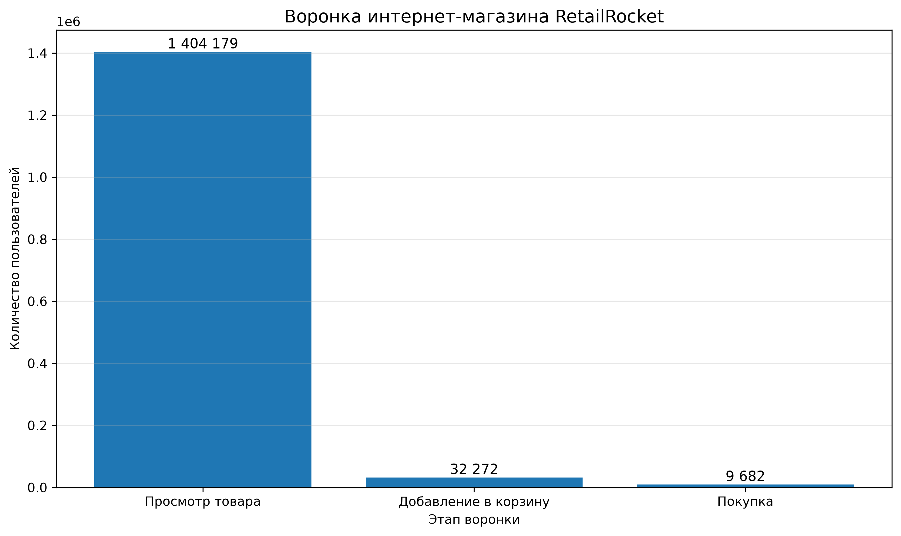
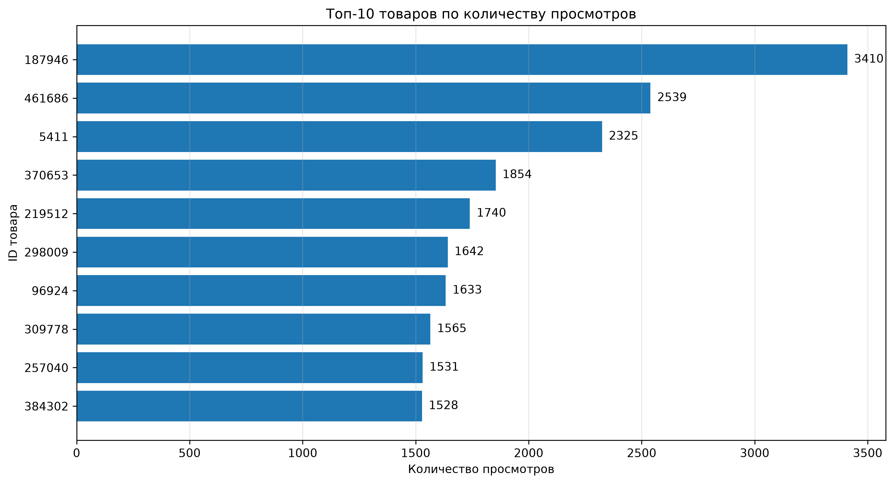
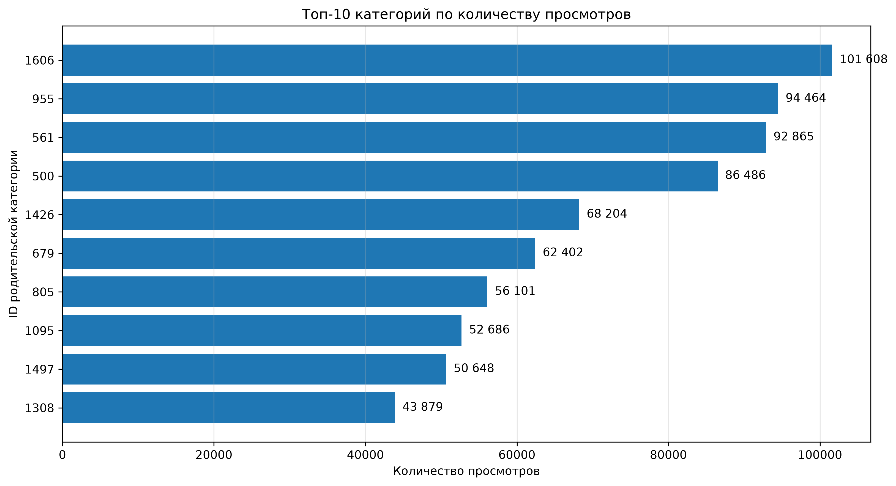

# Анализ поведения пользователей интернет-магазина (RetailRocket)

## О проекте

Учебный аналитический проект на основе датасета RetailRocket.

**Цель проекта:** изучить поведение пользователей интернет-магазина, проанализировать путь от просмотра товара до покупки, определить наиболее востребованные товары и категории, а также выявить товары с большим количеством просмотров, но без зарегистрированных покупок.

## Инструменты

- SQL
- DuckDB
- DBeaver

## Данные

В проекте используется датасет RetailRocket, содержащий информацию о событиях пользователей, свойствах товаров и дереве категорий.

Основные файлы:
- `events.csv` — события пользователей;
- `item_properties_part1.csv` и `item_properties_part2.csv` — свойства товаров;
- `category_tree.csv` — структура категорий.

## Проведённый анализ

- Исследовательский анализ данных и проверка качества данных.
- Анализ пользовательской воронки.
- Анализ популярных товаров и категорий.
- Поиск товаров с большим количеством просмотров и без покупок.
- Анализ связи доступности товара с добавлением в корзину.

## Результаты

## Результаты анализа

### 1. Общая информация о данных

- Общее количество событий: **2 756 101**.
- Количество уникальных пользователей: **1 407 580**.
- Период наблюдений: с **3 мая по 18 сентября 2015 года**.
- Просмотры товаров: **2 664 312**.
- Добавления в корзину: **69 332**.
- События покупки: **22 457**.

### 2. Пользовательская воронка

На уровне пользователей проанализирована последовательность первых событий каждого типа:

- Просмотр товара: **1 404 179 пользователей**.
- Просмотр, после которого было добавление в корзину: **32 272 пользователя**.
- Полная последовательность от просмотра до добавления в корзину и покупки: **9 682 пользователя**.

Конверсия:
- Просмотр → добавление в корзину: **2,30%**.
- Добавление в корзину → покупка: **30,00%**.
- Просмотр → покупка: **0,69%**.

### 3. Анализ товаров

- Товар с наибольшим количеством просмотров — `187946` (**3 410 просмотров**).
- Товар с наибольшим количеством событий покупки — `461686` (**133 события покупки**).
- Для товара `187946` зарегистрировано 2 добавления в корзину и ни одной покупки.

### 4. Анализ низкоконверсионных товаров

Найдены 40 товаров, у которых было не менее 500 просмотров и не было событий покупки:

- 30 товаров имели последнюю запись о доступности со значением `0`.
- 5 товаров — со значением `1`.
- Для 5 товаров статус неизвестен.

У доступных товаров среднее количество добавлений в корзину составило 7,4 события, у недоступных — 0,63.

### 5. Качество данных

- В основных полях `timestamp`, `visitorid`, `event` и `itemid` пропуски отсутствуют.
- Обнаружено 458 групп полностью совпадающих записей по проверенным полям. Автоматическое удаление не выполнялось.

## Ограничения исследования

- В датасете отсутствуют цены и выручка, поэтому финансовые показатели не рассчитывались.
- События пользователей анализировались за весь период наблюдений, а не в рамках отдельных сессий.
- Последний известный статус доступности товара не обязательно совпадает со статусом на момент взаимодействия.
- Названия категорий в данных отсутствуют, используются идентификаторы.
- Отношение количества событий покупки к просмотрам не является пользовательской конверсией.
- Выявленные взаимосвязи не доказывают причинно-следственную связь.

## Визуализация результатов

### 1. Воронка пользователей

### 2. Топ-10 товаров по просмотрам

### 3. Топ-10 категорий по просмотрам

## Бизнес-выводы

По результатам анализа данных RetailRocket выявлены следующие закономерности:

1. **Низкая конверсия из просмотра в корзину.** Только 2,30% пользователей, просмотревших товары, впоследствии добавили товар в корзину. Это может указывать на возможные сложности на этапе выбора товара.

2. **Конверсия из корзины в покупку составляет 30%.** Значительная часть пользователей, добавивших товар в корзину, не совершила покупку. Стоит дополнительно изучить причины отказа от оформления заказа.

3. **Высокий интерес не всегда приводит к покупке.** Товар с ID 187946 получил 3 410 просмотров и 2 добавления в корзину, но не имел событий покупки.

4. **Доступность товара может влиять на взаимодействие с ним.** Среди товаров без покупок и с известным статусом доступности товары со статусом available = 1 имели в среднем 7,4 добавления в корзину, а со статусом available = 0 — 0,63. Однако выборка доступных товаров мала, поэтому результат требует дополнительной проверки.

5. **Интерес пользователей распределён между разными категориями.** Наибольшее количество просмотров получила родительская категория 1606 — 101 608 просмотров.

### Рекомендации

- Изучить причины низкой конверсии из просмотра в добавление в корзину.
- Проверить процесс оформления заказа и причины отказа от покупки.
- Дополнительно исследовать влияние доступности товаров на поведение пользователей.
- Провести более детальный анализ категорий и товаров с высокой посещаемостью.
